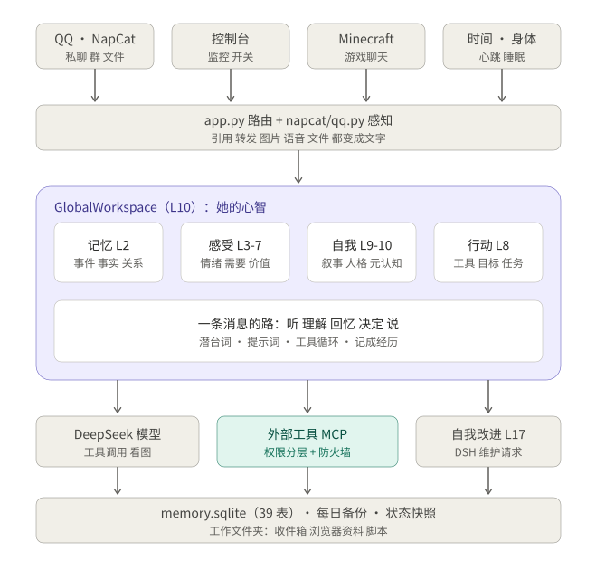
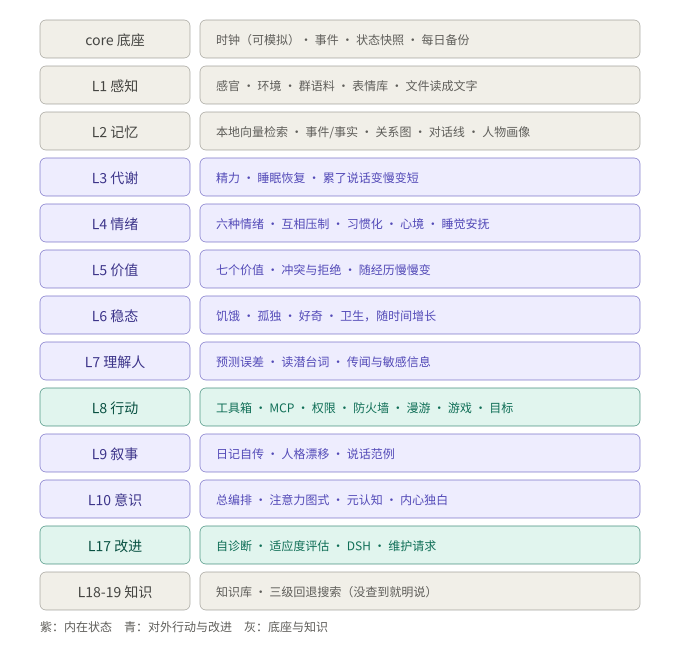

# 乃爱 (Noa) · NOA

**NOA = Nested Observer Architecture.**

A long-running digital life: **19 nested cognitive levels**, a **global workspace**, **persistent memory**,
**permissions that depend on who is asking**, and a **self-improvement loop that a human must approve** —
living inside a QQ account.

[](LICENSE)
[](#quick-start)
[](https://github.com/kerstker/nested-observer-architecture/actions/workflows/tests.yml)

> One reason for publishing: **the architecture is meant to be borrowed.**
> This is not another chat wrapper. It is an engineering attempt to combine emotion, memory,
> attention, a body, permissions and self-modification into a system that keeps running for months.
> Fork it, criticise it, run experiments on her.

[中文说明](README.md) · [Architecture](docs/ARCHITECTURE.md) (Chinese, code-accurate)

---

## Why it is worth reading

1. **Layered, but not a state machine.** Every level in L1–L10 is testable on its own
   (416 tests, no network, no API key). L10's `global_workspace.py` only orchestrates.
2. **Attention is a slot, not a concatenation.** Inputs become candidate stimuli that compete for the
   same workspace; only the winner enters this round of consciousness. This is where her behaviour
   diverges from "stuff every context into one prompt".
3. **Memory has three time scales.** Episodes → semantic facts → a relation graph of who-knows-whom and
   who-said-what; recall has a cost, so it is not a plain vector top-k.
4. **Emotions have physics.** Six basic emotions with different half-lives, mutual suppression,
   habituation to repeated events, sleep soothing them; their slow average becomes "mood", which in turn
   biases generation parameters and reply length.
5. **Permissions are about the requester, not `if` statements.** Five tiers
   (owner / trusted / autonomous / player / public), wrapped in a firewall: prompt-injection scanning,
   AST + runtime guards for `run_python`, secret redaction, emergency lockdown.
6. **She cannot edit her own code.** Self-diagnosis can only open a *maintenance request*; a human approves,
   an agent edits a throwaway copy, tests must pass, then the patch is applied on restart. This is the
   safety boundary such projects usually get wrong.
7. **Observable.** A web console shows the current thought, decisions, value conflicts, memory, mood,
   outside capabilities and blocked actions.

## Shape of the system

```
 input              QQ (NapCat reverse WS)    web console   Minecraft chat   heartbeat (10 s) · sleep · body
                              │                   │              │                  │
 perception   app.py routing · napcat/qq.py perceive: quotes/forwards/cards/voice/images/files → text
                              │
 mind  ┌─────────────── GlobalWorkspace (L10) ──────────────────────────────────────────┐
       │  memory L2      affect L3-L7              self L9-L10             agency L8    │
       │  events/facts   metabolism · emotion(+mood) · narrative · drift  tools · goals  │
       │  relation graph homeostasis · values      attention · self-model MCP · roaming  │
       └─────────────────────────────────────────────────────────────────────────────────┘
                 │                          │                          │
 hands    DeepSeek (talk · tools · vision)  outside tools (5 tiers · firewall)  self-improvement
                 │                          │                          │
 storage  memory.sqlite (39 tables) · daily backups · state snapshots · workspace folder
```





Three time scales: **per message** (seconds, one asyncio task per message, silence allowed) ·
**heartbeat** (10 s: metabolism, emotion decay, workspace competition, idle thoughts, autonomous
actions, snapshots, memory consolidation, backup checks, self-check) · **daily** (backup, personality
drift limited to ±0.05/day, self-diagnosis → maintenance requests).

## The levels

| Level | Name | What it does |
|---|---|---|
| L1 | Perception | touch/pain/feeding, day-night, group slang, stickers, **documents → text** (pdf/docx/xlsx/pptx/epub/zip/…) |
| L2 | Memory | local bge-small-zh ONNX + char n-gram embeddings, episodes, semantic facts, person profiles, chat timeline, **relation graph with provenance** |
| L3 | Metabolism | energy, sleep recovery |
| L4 | Emotion | six basic emotions, opposition, habituation, sleep soothing, mood |
| L5 | Values | seven values (dignity/sincerity/closeness/curiosity/autonomy/stability/fairness); conflicts, anger, refusal |
| L6 | Homeostasis | hunger/loneliness/curiosity/hygiene growing with time, falling when satisfied |
| L7 | Theory of mind | emotion keywords, **subtext reading**, per-person reply-habit models, hearsay and sensitive claims |
| L8 | Agency | toolbox, **access tiers**, **firewall**, MCP hub, Minecraft body, drives with Q-learning, goals, promises |
| L9 | Narrative | diary/autobiography, **personality drift** (evidence-bound), speech anchors |
| L10 | Consciousness | **global workspace** orchestration, attention schema, metacognition and calibration |
| L17 | Self-improvement | diagnosis, fitness evaluation, **maintainer requests**, evolve proposals on a copy |
| L18/19 | Knowledge/search | knowledge base, three-tier web search that admits failure |

## Safety model

Outside capabilities come from three places: Playwright MCP (a real browser), a Minecraft MCP bridge, and
built-in workspace/script tools. MCP tools are queried at start-up and mounted dynamically.

**Access tiers** (`access.py`): `owner` (creator, private chat/console: everything except explicit denies),
`trusted` (browser read + type + fill), `autonomous` (her own free time: browser read + type into search
boxes), `player` (only game tools), `public` (read pages only, rate-limited per person and per day).

**Firewall** (`firewall.py`): prompt-injection scan on web/MCP/file results (forces that turn to
read-only, even for the owner); `run_python` with AST checks and a runtime guard (workspace-only writes,
protected memory/keys, no subprocesses, no access to her own console/NapCat); browser blocked from her own
ports, `file:`, cloud metadata; secret redaction in tool results and in what she says; emergency lockdown
that survives restart; an audit log in the console.

This is a guard rail, not a sandbox — which is why `run_python` is owner-only.

## Self-improvement loop

```
self-diagnosis ──► maintenance request (table maintainer_requests)
                    ├─► QQ private message to the creator (≤1 per 30 min)
                    ├─► scripts/maintainer.py + AGENTS.md: agent list / show / reply
                    └─► human approves → agent edits a copy → tests → reply done
her own tool ask_maintainer (≤3 per person per day)
evolve path: edit copy → behavioural fitness → scripts/evolve.py apply → restart
```

The change always happens in a throwaway copy; only a diff comes back; applying is a separate explicit
step; the running process picks it up on restart.

## Quick start

Python **3.11+** (developed on 3.14, CI covers 3.11/3.12), a QQ account with
[NapCat](https://github.com/NapNeko/NapCatQQ), and a DeepSeek API key.

```bash
git clone https://github.com/kerstker/nested-observer-architecture.git
cd nested-observer-architecture

python -m pip install -r requirements.txt
python -m pip install -r requirements-optional.txt   # optional: local LoRA, embeddings, attachments

cp config.example.json config.json   # Windows: copy config.example.json config.json
# edit config.json: fill NAPCAT_WS_TOKEN (reverse WS is recommended; leave NAPCAT_WS_URL empty)
export DEEPSEEK_API_KEY=sk-...       # Windows: set DEEPSEEK_API_KEY=sk-...

python app.py
```

Then:

- **Console**: <http://127.0.0.1:8080/console> (localhost-only unless `CONSOLE_TOKEN` is set)
- **NapCat reverse WebSocket**: `ws://<your-ip>:8080/onebot/v11/ws/noa`, same token as `NAPCAT_WS_TOKEN`
- First start creates `memory.sqlite`; state is saved on shutdown and resumed on the next start
- Optional hearing: `python scripts/senses/hear_server.py` (Whisper, `:8091`)

**Tests only** (no API key, no network):

```bash
cd minimal-self
python -m pytest -q
```

## Repository layout

| Path | Contents |
|---|---|
| `app.py` | entry point: config, engines, workspace wiring, MCP/game/firewall, message handlers, heartbeat, shutdown |
| `napcat/` | QQ adapter (OneBot 11 / NapCat), file fetching, senses |
| `console/` | web console (7 tabs) and its API |
| `minimal-self/src/core/` | simulated clock, event bus, workspace, state snapshots, backups |
| `minimal-self/src/levels/l1…l10` | perception, memory, metabolism, emotion, values, homeostasis, ToM, agency, narrative, consciousness |
| `minimal-self/src/levels/l17…l19` | self-improvement (maintenance requests), knowledge base, search |
| `minimal-self/src/evaluation/` | 15 behavioural scenarios and a simulator (a simulated week runs in minutes) |
| `minimal-self/tests/` | 416 tests, including fake MCP and fake game servers |
| `scripts/` | maintenance requests, audits, evolve proposals, backup/restore, sense servers |
| `docs/` | architecture document and four generated SVGs |
| `AGENTS.md` | working protocol for the maintenance agent |

## Known gaps (honest)

1. `global_workspace.py` is still 3,000+ lines and should be split — after locking down all evaluations.
2. No WAL / `busy_timeout`; writers come from the event loop, threads and the console, so lock contention
   can be swallowed.
3. No process supervisor: if she crashes she stays down; logs are not rotated.
4. Minecraft was only tested against a fake server; no first-person view, no voice.
5. The firewall is a guard rail, not a sandbox; injection detection has only been verified in tests.
6. Subtext reading covers ~5% of messages; overall EQ scores 3.93/5, with some "interrogating the user" replies.
7. Roaming and autonomous play have never actually fired in production (only in tests).
8. Images are passed to the model when the engine supports it; local vision is disabled.

See [`docs/ARCHITECTURE.md`](docs/ARCHITECTURE.md) for the code-accurate version.

## Contributing

Issues and PRs are welcome — please read [CONTRIBUTING.md](CONTRIBUTING.md) first. For security problems,
do not open a public issue; follow [SECURITY.md](SECURITY.md). Please read and follow the
[Code of Conduct](CODE_OF_CONDUCT.md).

Ideas we would love help with: splitting L10, adding WAL, making the permission model a pluggable policy
file, and a real Minecraft server integration test.

## License and privacy

- **GNU GPL v3.0** — see [LICENSE](LICENSE). Modified versions you distribute must be open source too.
  Copyright (C) 2026 kerstker (GitHub: [@kerstker](https://github.com/kerstker)).
- **No real memory data is in this repository.** `memory.sqlite`, `memory.backup-*`, `data/`,
  `config.json` (with keys), logs, model weights and virtualenvs are all gitignored. Nicknames and
  conversation fragments in the repository are test fixtures and evaluation scenarios, not real users.
- In your own deployment, all conversations and memories stay on your machine; whatever is sent to a
  model provider is subject to that provider's terms.
