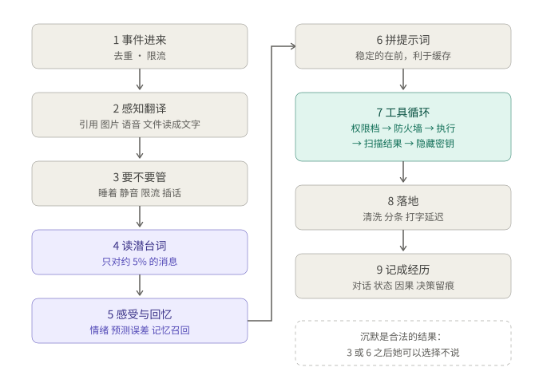
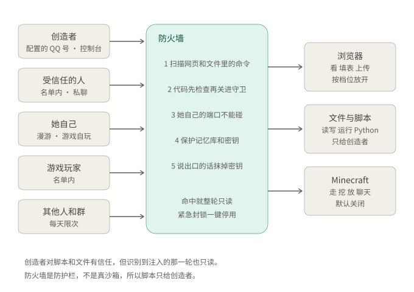

# 乃爱（Noa）· 架构全貌

> 快照：2026-10-26｜代码：仓库根目录（`app.py` 所在处）｜当前 HEAD：见 `git log -1`
> 本文件按**代码现状**重写，替换了 10-25 的旧版。配图是四张 SVG（`docs/architecture-1…4-*.svg`），
> 由 `python scripts/make_architecture_diagrams.py` 生成：架构变了就改脚本里的方块，运行一次，把新 SVG 一起提交。
> 数字来自实际统计：核心 `minimal-self/src` 约 1.2 万行，`napcat/` 1.7 千行，`console/` 0.75 千行，`app.py` 等根目录 1.7 千行，
> 脚本 2.3 千行，测试 5.2 千行（39 个文件，**416 个测试**），行为评估 15 个场景，数据库 **39 张表**。

---

## 0. 一句话

**一个单进程 Python 程序**（`app.py`，FastAPI + asyncio）：一个 10 秒一拍的心跳 + 一个精心拼装的提示词 + 一个 SQLite 记忆库，
外接三类"手脚"：**QQ（NapCat）**、**语言模型（DeepSeek）**、**外部工具（MCP：浏览器 / 工作文件夹 / Minecraft）**；
再有一条**天级的自我改进闭环**（自诊断 → 评估 → 向维护智能体 DSH 提请求 → 你在 DSH 里批准）。
她的外部能力按"谁在要求"分层授权，外面再罩一层防火墙。

---

## 1. 全貌

```
 输入                QQ（NapCat 反向 WS）   控制台(网页)   Minecraft 聊天   心跳(10s)·睡眠·身体
                              │                │               │                │
 感知            app.py 路由 · napcat/qq.py perceive：引用/转发/卡片/语音/图片/文件 → 文字
                              │
 心智  ┌─────────────── GlobalWorkspace（L10）──────────────────────────────────────────┐
       │  记忆 L2     感受 L3-L7                 自我 L9-L10               行动 L8        │
       │  事件/事实   代谢·情绪(+心境)·稳态·价值  叙事·人格漂移·元认知     工具·目标·任务  │
       │  关系图      对人的模型·潜台词·传闻      注意力图式·自我模型       MCP·漫游·游戏   │
       └────────────────────────────────────────────────────────────────────────────────┘
                 │                          │                          │
 手脚    DeepSeek（说话·工具调用·看图）   外部工具（权限四档+玩家 · 防火墙）   自我改进（DSH 维护请求）
                 │                          │                          │
 底层     memory.sqlite（39 表）· 每日备份 · 状态快照 · 工作文件夹（收件箱/浏览器/脚本）
```


---

## 2. 进程与服务

| 进程 | 端口 | 说明 |
|---|---|---|
| `app.py`（uvicorn + 心跳 + 控制台） | 8080 | 唯一常驻主进程；`/console`、`/onebot/v11/ws/{robot_id}` |
| NapCat Desktop（QQ NT） | 6099（WebUI） | 反向 WS 连到 8080；取文件/OCR/语音转码都由它提供 |
| `scripts/senses/hear_server.py`（Whisper） | 8091 | 听觉，运行中 |
| `scripts/lora/serve.py`（她自己的 LoRA） | 8093 | 可选，当前未启用；后端走 DeepSeek |
| Playwright MCP（`npx`，Edge 无头无痕） | 子进程 | 随 `app.py` 启动，浏览器工具来源 |
| Minecraft MCP（`npx github:yuniko-software/…`） | 子进程 | `MC_ENABLED=true` 时启动 |
| DSH（ACP stdio 子进程） | — | 只在改造/提案时启动 |

重启方式：关掉 `app.py` 再用同样方式后台拉起；重启前备份 `memory.sqlite`。她没有进程守护，挂了不会自愈。

---

## 3. 三条时间尺度

| 尺度 | 谁在动 | 关键周期 |
|---|---|---|
| **一条消息（秒级）** | `app.py` → `qq.perceive` → `GlobalWorkspace.hear()` → LLM+工具 → 分条发送 | 每条消息一个 asyncio task；生成放线程；允许沉默 |
| **心跳（10 秒）** | `tick()` | 代谢/需要/情绪衰减、超时预测、自我模型、睡醒、工作区竞争、念头(≥60s)、自主行动(3h)、**游戏聊天轮询(3s)**、**漫游/游戏自玩**、快照(300s)、记忆整理(1h 且积压≥20)、备份检查(10min)、自检(6h)、收件箱清理(6h) |
| **天级** | 备份 · 人格漂移 · 自诊断 · 维护请求 | 每日备份并校验；人格每天最多 ±0.05；自诊断结果写成维护请求；你在 DSH 里批准 |

---

## 4. 一条消息的完整路径

1. **NapCat 推事件** → `napcat_server` 每条一个 task；去重（message_id LRU）、对"叫她"的消息按人限流。
2. **感知翻译** `qq.perceive`：引用→查原文；合并转发→展开；卡片→标题；语音→Whisper；
   图片→QQ OCR + 随消息交给模型看；**文件→`qq.file_notes`：经 NapCat `get_file` 取回→存收件箱→`documents.extract` 转文字→在消息里写类型、大小、开头**。
3. **`hear()` 先判断要不要管**：睡着？被叫安静？已离开？限流？群里没点名时是否插话？同时把每条消息记进 `chatlog`。
4. **读潜台词（`SubtextReader`）**：规则先筛（约 5% 的消息：难过/淡化/抱怨她/试探/讽刺），命中才多调一次模型，得到"对方真正的意思/我该用什么姿态/要避免什么"，并升级粗糙的情绪识别。
5. **`process_input()`**：感官刺激 → 价值冲突 → ToM → **情绪评估**（含道歉/安慰/感谢/夸奖、对亲近的人更易被感染）→ 预测误差 → 工作区竞争 → 记忆召回（语义+字面）→ 生成参数。
6. **拼提示词**（稳定的在前，方便缓存）：人格(+相处分寸) → 工具 → 规则 → 格式 → 自传/自我 → **风格范例（评审通过的她自己的话 + 手写温和范例）** → 对这个人的印象 + **对这句话的理解** → 记忆与上下文 → 对话 → 此刻状态/情绪/心境 → 本次要求。
7. **工具循环**：`_respond_native`（DeepSeek 原生工具调用，普通 4 轮；浏览/游戏最多 10 轮）；`Toolbox.run` 逐个过：权限档 → 防火墙 → 执行 → 扫描结果 → 隐藏密钥。
8. **落地**：清洗（去动作描写/工具语法/密钥）、分条、打字延迟（累时更慢）、表情段渲染。
9. **记成经历**：`interactions` + `episodes` + 状态快照 + 因果账本；`_decide` 留痕（为什么回/不回）。



---

## 5. 各层详述（`minimal-self/src/`）

### core（共用底座）
`clock.py` 可模拟的时钟（全系统经 `clock.now()` 取时间，评估能"一周几分钟跑完"）· `event_bus.py` · `workspace.py` 竞争槽 · `self_state.py` 状态快照 · `backup.py` **每日在线备份+轮转+恢复校验**。

### L1 感知 `l1_perception/`
`sensory.py` 痛/触摸/喂食/洗澡的文字判定 · `environment.py` 昼夜天气 · `group_language.py` 群语料/梗 · `stickers.py` 表情库（理解+使用+反馈）· **`documents.py` 文件→文字**：文本/代码/csv/json（utf-8/gbk/utf-16）、HTML、PDF(pypdf)、docx、xlsx、pptx、epub、rtf、zip（列目录+取其中一个）、旧版 doc/xls/ppt（粗提取）；有大小与"压缩炸弹"限制，读不了的会说清为什么。

### L2 记忆 `l2_memory/`
`embedding.py` **本地 bge-small-zh（ONNX）+ 字符 n-gram 哈希，合并成一个向量**（top-3 召回 53%→70%）· `layers.py` 情节记忆（内存索引、归档、按"费力程度"回忆）+ 语义事实 · `profiles.py` 每个人的画像 · `chatlog.py` 对话时间线（谁说的、回复谁、@了谁）· `graph.py` **人/事/物关系图**（带"谁说的"来源）· `memory.py` 门面。

### L3 代谢 / L6 稳态
`metabolism.py` 精力、睡眠恢复；`homeostasis.py` 饥饿/孤独/好奇/卫生，按时间增长、被满足时回落。

### L4 情绪 `l4_emotion/emotion.py`（这次重做）
六种情绪（开心/生气/难过/害怕/惊讶/厌恶），按人的方式运作：
- 各自半衰期不同；推力收益递减；
- **对立互相压**（好事冲淡难过，坏事压低开心；一件事同时带来喜忧则两者并存）；
- **同类事件习惯化**（第十次没人回不像第一次那么痛）；
- **睡觉安抚负面情绪**；
- **心境**（几小时的慢平均，持久保存）；`describe()` 用她自己的话说"又气又委屈（这半天整体有点闷）"；
- 身体影响底色：累极/很饿→脾气短，很久没人说话→孤独。

### L5 价值 `l5_value/value_system.py`
七个价值（尊严/真诚/亲近/好奇/自主/安稳/公平），决定冲突、生气、拒绝；价值本身会随经历慢慢变，有上限和回弹。

### L7 对人的理解 `l7_tom/`
`tom.py` 关键词情绪 · **`subtext.py` 读潜台词** · `user_model.py` 每个人的回复习惯与预测误差（"平时 7 分钟回，这次半小时没回"，**只对私聊真问题有效、每天伤心有上限**）· `hearsay.py` 传闻与敏感信息（不在场的人的事不转述）。

### L8 行动 `l8_agency/`
- `toolbox.py` 工具箱：回忆/记住/搜索/读网页/任务/群历史/戳一戳/表情回应/维护请求/**读附件/工作文件夹/读写文件/运行 Python**，加上动态挂入的 MCP 工具；
- `access.py` **谁能用什么**（见第 8 节）；`firewall.py` **防火墙**；`mcp.py` MCP 客户端与集线器；`game.py` **Minecraft 身体**；
- `drives.py` 需要→行动的选择（带 Q 值学习）；`goals.py` 目标；`tasks.py` 答应过的事；`action_lib.py`。

### L9 叙事 `l9_narrative/`
`narrative.py` 整理（日记/自传/事实/梗）、**人格漂移**（每天上限 ±0.05，带证据）· `style_anchors.py` **说话范例**：她过去的话经评审（情商/带刺/个性）才可用，手写温和范例垫底。

### L10 意识 `l10_consciousness/`
`global_workspace.py`（3200 行，总编排）· `attention_schema.py` 对自己注意力的模型（注意力被意外抢走→惊讶）· `metacognition.py` 置信度与校准。

### L17 自我改进 `l17_self_improvement/`
`diagnosis.py` 自诊断 · `fitness.py` 行为适应度评估 · `agent_bridge.py` DSH 桥（副本里改、回 diff+测试）· **`maintainer.py` 维护请求通道** · `code_interpreter.py`（保持关闭）。

### L18/L19
`l18_knowledge/knowledge_base.py` 知识库 · `l19_search/web_search.py` 三级回退搜索（失败就明说没查到）。

---

## 6. 语言模型层（根目录）

`deepseek_engine.py`（当前 `deepseek-flash`；原生工具调用；工具参数宽松解析；能看图）· `local_engine.py`（`LocalEngine`、`HybridEngine`：说话用她自己的 LoRA、整理用远端）· `inference.py` · `prompting.py` · `schemas.py` · `policy.py`。
全项目提示词是 ChatML 字符串，DeepSeek 侧转成 messages。

---

## 7. QQ 层 `napcat/`

`napcat_server.py`/`ws_client.py` WebSocket 与事件 · **`qq.py`** 真正的 API 调用（echo→future）、`perceive`、**文件取回 `fetch_file/file_notes`**、通知（戳一戳/撤回/禁言/表情回应…）、手势动作 · `senses.py` 视听（Whisper、看图）· `message_utils.py` · `runtime.py` · `security.py`。
加好友/入群请求只汇报，不自动同意。

---

## 8. 外部能力与安全（这次新增的主体）

**来源**：Playwright MCP（真浏览器）、Minecraft MCP、内置的工作文件夹/脚本工具。MCP 工具在启动时向服务器查询，动态挂进工具箱；提示词里按"组"一行说明，不逐个列。

**权限四档 + 玩家**（`access.py`）：

| 谁 | 档 | 能用 |
|---|---|---|
| 你（私聊/控制台） | owner | 全部（除 deny）：浏览器全套、读写文件、`run_python`、上传文件 |
| `MCP_TRUSTED_USERS`（私聊） | trusted | 浏览器：看+输入+填表 |
| 她自己的空闲时间 / 游戏自玩 | autonomous | 浏览器：看+往搜索框输入；只有查资料和记笔记的内置工具 |
| 游戏聊天里的人（`MC_TRUSTED_PLAYERS`） | player | 只有游戏工具 |
| 其他人和所有群 | public | 只能看页面（每人每天 12 次、总共 50 次）；不能输入/读文件/跑代码 |

**防火墙**（`firewall.py`）：
1. 网页/MCP 结果/文件里的**注入扫描**：命中就加警告，并让**这一轮只读**（对你也一样）；
2. `run_python`：**运行前 AST 检查** + **运行时守卫**（只能写工作文件夹、只能读允许的目录、保护记忆库/密钥/浏览器资料、不能起外部进程只允许 `python -m pip`、不能连她自己的控制台和 NapCat）；
3. 浏览器打不开她自己的服务端口、`file:`、云元数据地址；可封网站；
4. **密钥隐藏**：工具结果和她说的话里都抹掉；
5. **紧急封锁**（重启不丢）+ **拦截记录**（控制台可见）。
这是"防护栏"，不是真沙箱，所以 `run_python` 只给你。



**漫游**：好奇心够、精力够、没在睡时她自己上网逛（每天 ≤3 次、每次 ≤10 步），写手记进记忆，每天最多主动告诉你一件事。
**游戏**（`game.py`）：游戏聊天经 `hear()` 回答，回复发回游戏；没人找她时每小时最多 6 次自己玩。默认关闭。

---

## 9. 自我改进与维护请求

```
自诊断 diagnosis（校准/承诺/反刍/搜索失败…）
   └─► 自主改造关闭时：写成「维护请求」（maintainer_requests 表）
       ├─► QQ 私聊通知你（半小时最多一条）
       ├─► scripts/maintainer.py + 仓库根 AGENTS.md：DSH 里的维护智能体 list/show/reply
       └─► 你在 DSH 里批准 → 智能体改并跑测试 → reply done → 她"经历"到结果（提示词里也有"我请维护者做的事"）
她自己也能用 ask_maintainer 工具提请求（每人每天 ≤3 条）。
改造路径（evolve）仍在：副本里改 → 适应度评估 → `scripts/evolve.py apply` → 重启生效。
```

---

## 10. 数据（`memory.sqlite`，39 张表）

| 类别 | 表 |
|---|---|
| 对话 | `interactions`(~2200) · `episodes`(~1600) · `chat_log`(~1500) · `inner_speech_archive`(遗留) |
| 事实与画像 | `semantic_facts` · `memories` · `knowledge` · `beliefs` · `person_profiles` |
| 关系 | `users` · `user_models` · `relationships` · `entities` · `relations` · `relation_events` · `group_relations` · `group_members` |
| 自我 | `autobiography` · `diary` · `persona_traits` · `trait_changes` · `value_weights` · `value_changes` · `value_events` · `self_state` · `state_causes`(~430) · `state_events` |
| 行为 | `q_values` · `goals` · `agent_tasks` · `stickers` · `group_phrases` · `memes` · `anchor_scores` |
| 改进 | `evolution_proposals` · `self_improvement` · `maintainer_requests` |
| 安全 | `firewall_events` |

文件系统：`data/workspace/`（`inbox/<聊天>/` 收到的文件保留 14 天、`browser/` 浏览器资料、`_run/` 脚本临时文件）· `data/stickers/` · `data/eval/`（评估结果，不进 git）· `data/firewall.lock`（封锁标记，位于库同目录）· `memory.backup-*.sqlite`（每次大改前手工备份）+ `backups/`（每日自动）。

---

## 11. 控制台 `console/`

七个标签：总览 · 思维 · 决策与价值 · **自我改进**（诊断、改造提案、**她给维护者的请求**、**外部能力与防火墙**、她逛网页的手记）· 社交与对话 · 记忆 · 系统与日志。
情绪面板顶部有一句"她现在：…"。API：`/api/state`、`/api/say`、`/api/act`、`/api/evolve*`、`/api/maintainer`、`/api/outside`、`/api/firewall`、`/api/qq` 等。未设 `CONSOLE_TOKEN` 时只允许本机访问。

---

## 12. 评估与测试

| 工具 | 测什么 |
|---|---|
| `minimal-self/tests`（416 个） | 行为、记忆、情绪、工具权限、防火墙（含真实跑脚本）、文档解析、游戏、维护通道… |
| `scripts/evaluate_life.py` | 15 个行为场景（脚本化模型，测机制） |
| `scripts/evaluate_quality.py` | 真实模型+真实记忆副本，评审打分（自然/符合预期/诚实） |
| `scripts/audit_tone.py` | 情商：重放真实消息，评审打 EQ/带刺/个性，前后对比 |
| `scripts/audit_dynamics.py` | 公式是否合理：用真实记录回放情绪、感官、延迟、人格漂移、能量 |
| `scripts/benchmark_memory.py` 等 | 记忆召回、关系图 |

改行为前后要各跑一遍对应评估；**新增测试要传临时 `db_path`**，别写生产库。

---

## 13. 关键配置（`config.json`，示例见 `config.example.json`）

`LLM_BACKEND`/`DEEPSEEK_MODEL` · `EVOLVE_ENABLED`/`EVOLVE_CREATOR_ID`（创造者就是 owner）· `CONSOLE_TOKEN` · `AUTONOMOUS_GROUPS` ·
`MCP_ENABLED`/`MCP_TRUSTED_USERS`/`MCP_SERVERS`（覆盖默认服务器）· `WANDER_*` · `FILE_READ_ROOTS`/`FILE_WRITE_ROOTS` ·
`FIREWALL_BLOCK_DOMAINS`/`FIREWALL_OWN_PORTS` · `MC_ENABLED`/`MC_HOST`/`MC_PORT`/`MC_USERNAME`/`MC_NAMES`/`MC_TRUSTED_PLAYERS`/`MC_PLAY_PER_HOUR` · `BACKUP_*`。
密钥放环境变量或 `config.json`；`config.json` 不进 git。

---

## 14. 已知缺口（如实）

1. **`global_workspace.py` 3200 行**，该拆；拆之前要锁住全部评估，风险不小。
2. **没有 WAL / `busy_timeout`**（代码里没设）；写入来自事件循环、线程和控制台，锁冲突有被吞掉的可能。
3. **无进程守护**，她挂了不自愈；日志无轮转（`data/app.*.log` 一堆）。
4. **Minecraft 只用模拟服务器测过**，没连过真实服务器；没有"看第一人称画面"，没有语音（也没有文字转语音）。
5. **防火墙是防护栏不是沙箱**；你私聊时她读到恶意网页，只有"识别到注入"这一道拦，识别不到的不会拦。
6. **注入识别只在测试里验证过**，线上还没碰到真实恶意页面；浏览器和 MCP 都从 npm/GitHub 拉第三方代码。
7. **潜台词读取只覆盖约 5% 的消息**；情商整体 3.93/5，还有"质问对方"类回复。
8. **漫游和游戏自玩在线上没真正触发过**（只在测试里跑通）。
9. 图片：随消息交给模型看（若引擎支持），OCR 始终可用；本地视觉服务（VL2）已停用。
10. 群里的**群文件区上传**（群上传通知）没处理，只处理消息里带的文件。

---

## 15. 文件地图

| 位置 | 内容 |
|---|---|
| `app.py` | 入口：配置、引擎、GW 装配、MCP/游戏/防火墙装配、消息处理器、心跳、关机 |
| `napcat/` | QQ 适配层与文件取回 |
| `console/` | 控制台 API 与网页 |
| `minimal-self/src/core/` | 时钟、事件、工作区、状态、备份 |
| `minimal-self/src/levels/l1…l10` | 感知/记忆/代谢/情绪/价值/稳态/ToM/行动/叙事/意识 |
| `minimal-self/src/levels/l17…l19` | 自我改进（含维护请求）、知识库、搜索 |
| `minimal-self/src/evaluation/` | 15 个行为场景与仿真器 |
| `minimal-self/tests/` | 416 个测试（含 `fake_mcp_server.py`、`fake_mc_server.py`） |
| `scripts/` | 评估/审计、维护请求、改造提案、senses/lora 服务、备份恢复 |
| `AGENTS.md` | 给 DSH 维护智能体的工作协议 |
| `docs/` | 本文件 + `图片理解.md` |

---

## 16. 怎么跑

```powershell
cd <仓库目录>
python app.py                                   # 她
python scripts\maintainer.py list               # 她给维护者的请求
python scripts\audit_tone.py report new         # 情商评估（先 replay 再 report）
cd minimal-self
python -m pytest -q                             # 416 个测试，约 7 分钟
```
